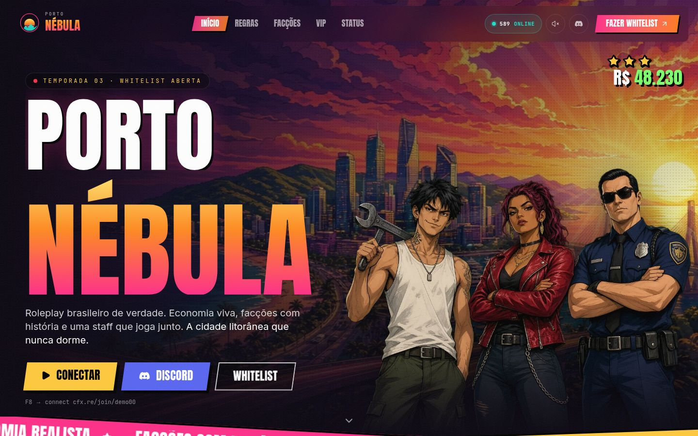
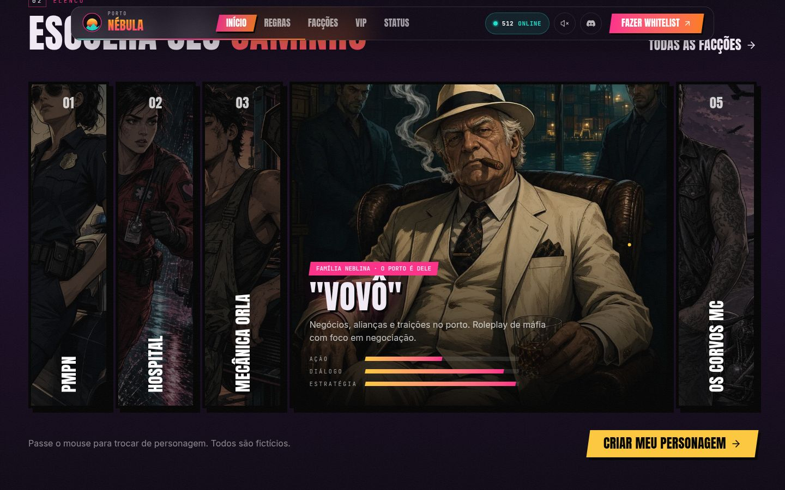
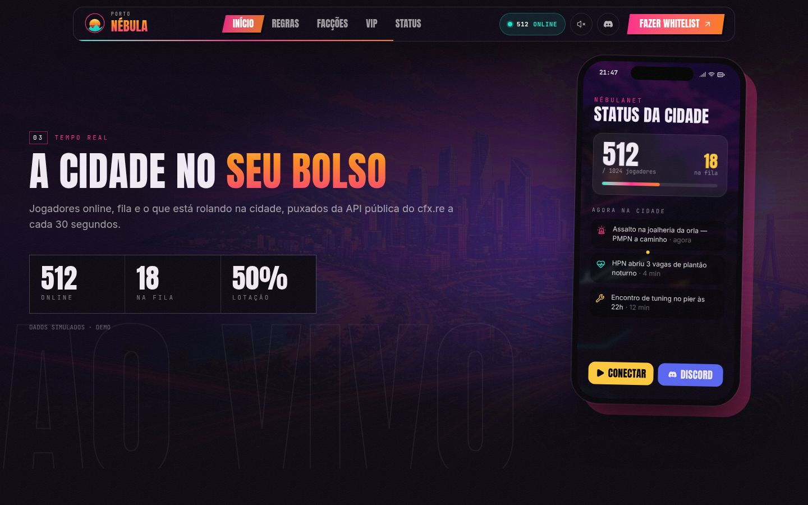
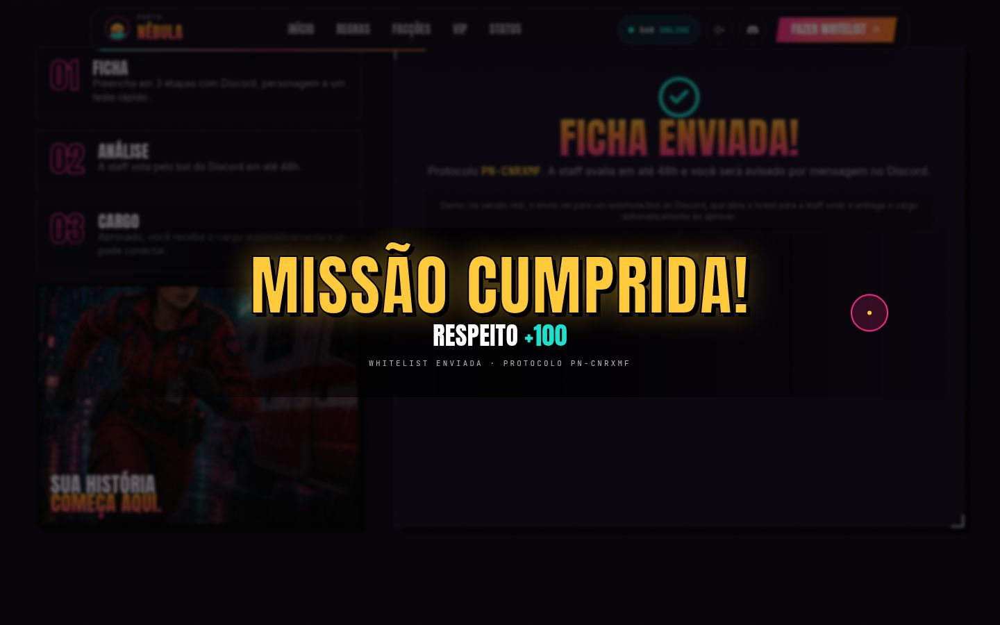
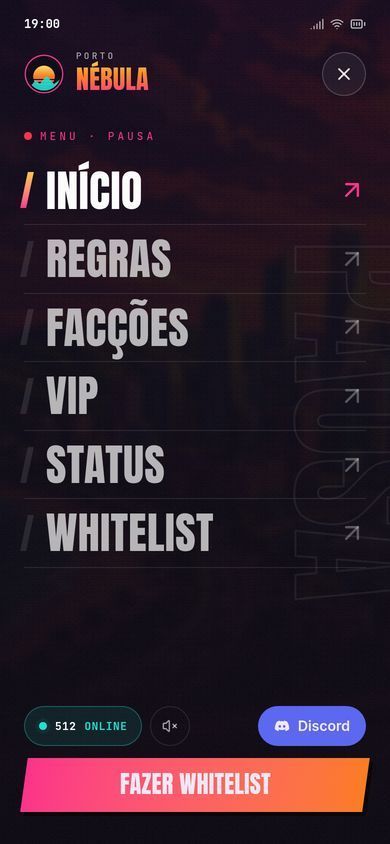

# Porto Nébula RP — site demonstrativo

Site de demonstração para uma **cidade fictícia de GTA RP (FiveM)**, feito para mostrar a donos de servidor o que dá para entregar: site da cidade com status ao vivo, loja VIP integrada ao Tebex, whitelist pela web e painel de facções — tudo em português.

> ⚠️ **Projeto demonstrativo — cidade fictícia.** Nomes, dados, números e personagens são ilustrativos. Sem afiliação com Rockstar Games, Take-Two Interactive ou Cfx.re. Ilustrações originais geradas para esta demo.



| Seleção de personagem | Status no celular | Whitelist enviada | Menu mobile |
| --- | --- | --- | --- |
|  |  |  |  |

## O que tem

- **Home** cinematográfica: parallax em camadas, Ken Burns, raios de sol animados, personagens recortados na frente do skyline, tickers, contadores, seleção de personagem e status num "celular" do jogo.
- **Status ao vivo** (`src/lib/fivem.ts`): consulta `servers-frontend.fivem.net/api/servers/single/<código>` com fallback para dados simulados. Defina `cfxCode` em `src/lib/site.ts`.
- **/vip** — pacotes cosméticos com checkout **somente via Tebex** (regra da plataforma FiveM).
- **/whitelist** — formulário em etapas com validação e tela de "missão cumprida". Na demo o envio é simulado (`src/lib/whitelist.ts`); na versão real, posta num webhook/bot do Discord.
- **/faccoes**, **/regras** (com busca) e **/status**.
- Loading screen uma vez por sessão, cursor customizado no desktop, sons de interface desligados por padrão e respeito a `prefers-reduced-motion`.

## Stack

Next.js (App Router, export estático) · React · TypeScript · Tailwind CSS v4 · Motion · Lenis · lucide-react

## Rodando localmente

```bash
npm install
npm run dev        # http://localhost:3000
npm run build      # gera o site estático em ./out
npm run preview    # serve ./out em http://localhost:4173
```

Textos, links (Discord, Tebex, connect) e dados ficam em `src/lib/site.ts` e `src/lib/data.ts`.

## Deploy no GitHub Pages

1. Suba o repositório para o GitHub (branch `main`).
2. Em **Settings → Pages**, escolha **Source: GitHub Actions**.
3. O workflow `.github/workflows/deploy.yml` faz o build com `NEXT_PUBLIC_BASE_PATH=/<nome-do-repo>` e publica `./out`.  
   Se o repositório se chamar `<usuario>.github.io`, o site é publicado na raiz (sem basePath).

Para testar a subpasta localmente:

```bash
NEXT_PUBLIC_BASE_PATH=/porto-nebula-rp npm run build
```

## Licença

Código de demonstração para portfólio. As imagens em `public/images` foram geradas especificamente para este projeto.
